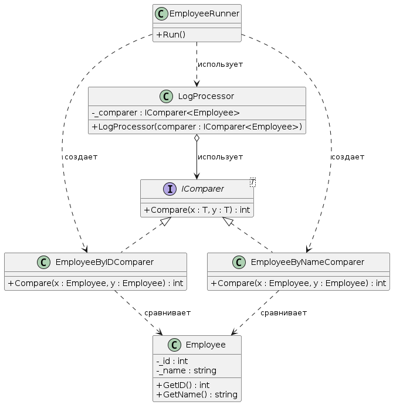
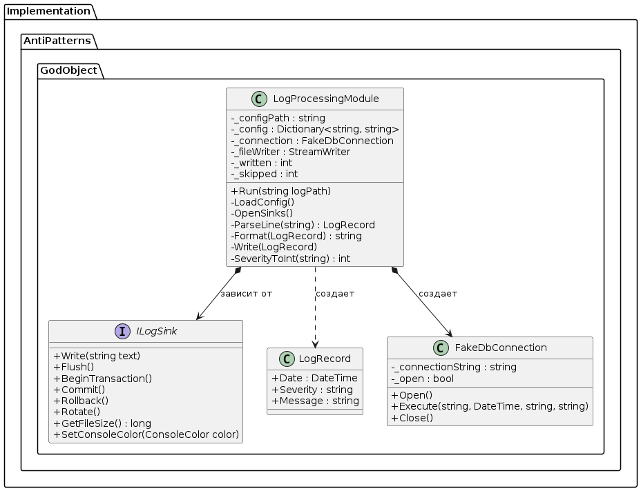
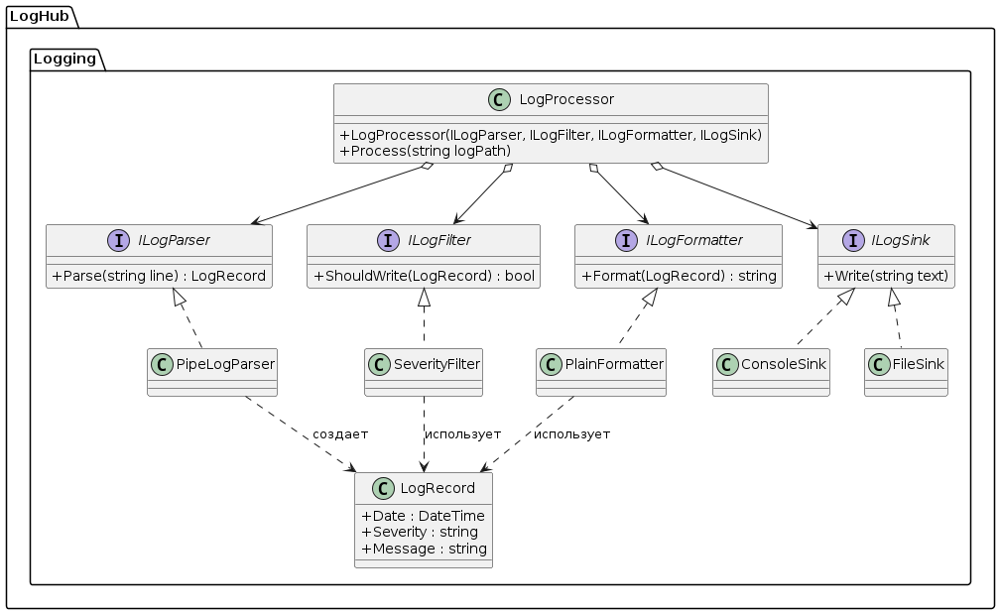

# Лабораторная работа 4. Git, среда и SOLID

**Репозиторий:** https://github.com/telarane/Lecture_Examples

## Задача
Настроить процесс разработки (Git, CI), изучить принципы SOLID на примере рефакторинга god-класса и проанализировать чужой код.

## Чтение чужого кода (Шаг 5)
Для анализа я выбрал паттерн **Стратегия** из папки `DesignPatterns/Implementation/Behavioral/Strategy`.

**Какая задача решается:**
В данном примере паттерн Стратегия используется для инкапсуляции алгоритмов сравнения сотрудников. Интерфейс `IComparer<Employee>` задает общий контракт для сравнения. Классы `EmployeeByIDComparer` и `EmployeeByNameComparer` реализуют этот интерфейс, предоставляя разные способы сортировки (по ID и по имени). Класс `EmployeeRunner` выступает в роли контекста: он получает конкретную стратегию сравнения извне и использует ее для обработки данных, не зная о деталях реализации. Это позволяет легко добавлять новые способы сортировки без изменения существующего кода класса-контекста, что полностью соответствует принципу открытости/закрытости (OCP).

**Диаграмма классов:**

## Анализ исходного кода (до рефакторинга)

На диаграмме представлен исходный класс `LogProcessingModule`. Как видно, он представляет собой «Божественный объект» (God Object):
1. **Внутренняя сложность:** Класс содержит 6 приватных полей для хранения состояния (пути к конфигу, соединения с БД, файлового потока, счетчиков).
2. **Смешение ответственности:** Методы `LoadConfig`, `OpenSinks`, `ParseLine`, `Format` и `Write` реализуют абсолютно разные задачи (чтение файлов, работу с БД, парсинг, форматирование, маршрутизацию).
3. **«Толстый» интерфейс:** Интерфейс `ILogSink` содержит 8 методов, большинство из которых не могут быть реализованы конкретными приёмниками (например, консоль не умеет делать `BeginTransaction` или `Rotate`).

## Анализ нарушений SOLID в классе LogProcessingModule

Класс `LogProcessingModule` нарушает все пять принципов SOLID.

| Принцип | Где нарушен | Почему это нарушение |
| :--- | :--- | :--- |
| **SRP** | Весь класс | У класса минимум 6 причин для изменения: чтение конфига, подключение к БД, парсинг, фильтрация, форматирование, маршрутизация. |
| **OCP** | Методы `OpenSinks`, `Write`, `SeverityToInt` | Три разных `switch`. Чтобы добавить новый приёмник, нужно менять существующий код. |
| **LSP** | Интерфейс `ILogSink` | Интерфейс требует реализовать методы, которые не могут быть реализованы (транзакции для консоли). |
| **ISP** | Интерфейс `ILogSink` | «Толстый» интерфейс. Клиенту, которому нужна только запись в консоль, приходится реализовывать методы для БД. |
| **DIP** | Поля класса `_connection`, `_fileWriter` | Класс сам создает зависимости (`new FakeDbConnection`, `new StreamWriter`). Бизнес-логика зависит от инфраструктуры. |

## Результаты рефакторинга

После рефакторинга класс `LogProcessor` больше не зависит от конкретных приёмников (OCP соблюден). Чтобы добавить новый приёмник (например, Telegram), достаточно создать класс `TelegramSink : ILogSink` и передать его в конструктор. Существующий код при этом не меняется, что полностью соответствует принципу открытости/закрытости. 

Логика разбора строки изолирована в `PipeLogParser` и может быть протестирована без обращения к файловой системе (DIP соблюден). Интерфейс `ILogSink` стал узким, теперь консоль не обязана реализовывать методы для работы с БД (ISP соблюден).

Все тесты (7 штук) не обращаются к диску, сети или базе данных, так как используют интерфейсы и фейковые реализации (`FakeSink`).