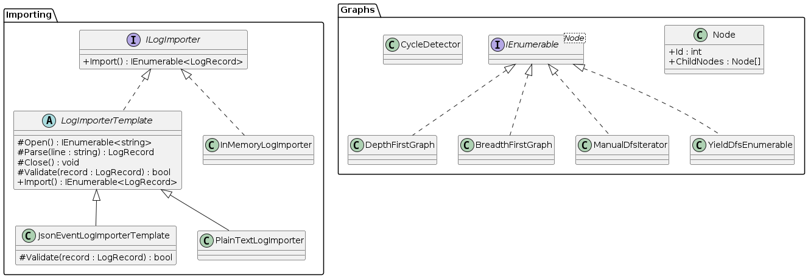

# Лабораторная работа 6. Импорт логов и обход графа

**Выполнил:** Соколов Андрей Романович (БИСО-01-24)
**Вариант:** 10 (Windows Event Log (JSON-выгрузка), приёмники: Консоль, файл, фильтр по источнику события)

## 1. Три источника логов (Паттерн Стратегия)
В рамках работы был реализован интерфейс `ILogImporter` (Стратегия). Созданы три реализации:
1. `JsonEventLogImporter` (и его шаблонная версия) — для чтения JSON-выгрузок Windows Event Log (соответствует варианту 10).
2. `PlainTextLogImporter` — для чтения текстовых файлов (формат `дата|уровень|источник|сообщение`).
3. `InMemoryLogImporter` — для тестирования без обращения к диску (DIP).

Паттерн **Стратегия** позволяет внедрять нужный импортер в `LogProcessor` в рантайме. Смена источника происходит через конфигурацию (`import.source`), без изменения кода и перекомпиляции.

## 2. Общий алгоритм (Паттерн Шаблонный метод)
Для избежания дублирования кода (открытие файла, чтение, закрытие) был создан абстрактный класс `LogImporterTemplate`.
*   Метод `Import()` является **невиртуальным** и содержит скелет алгоритма (Open -> Parse -> Validate -> Close).
*   Шаги `Open()`, `Parse()` и `Close()` объявлены **абстрактными**, их реализуют наследники.
*   Шаг `Validate()` является **хуком** (виртуальным методом с реализацией по умолчанию). По умолчанию он отбрасывает `null`.

## 3. Работа хука
В классе `JsonEventLogImporterTemplate` (наследник шаблона) переопределен метод `Validate()`. Для соответствия 10-му варианту он отсекает записи, у которых отсутствует поле `Source` (источник события). Остальные импортеры не переопределяют этот метод и о его существовании не знают.

## 4. Обход графа (Паттерн Итератор)
Для обхода графа зависимостей сервисов реализованы два независимых итератора:
*   `DepthFirstGraph` — обход в глубину (DFS) с использованием стека.
*   `BreadthFirstGraph` — обход в ширину (BFS) с использованием очереди.

Оба класса реализуют `IEnumerable<Node>` через `yield return`, что гарантирует создание **независимого курсора** при каждом вызове `foreach`. Это решает проблему антипаттерна «коллекция сама себе итератор» — вложенные циклы `foreach` работают корректно. Защита от зацикливания реализована через `HashSet<int> visited`. Для поиска конкретного цикла в графе добавлен класс `CycleDetector`.

## 5. Две реализации итератора и разбор yield return
Реализованы два варианта обхода DFS:
1. **Ручной** (`ManualDfsIterator`) — класс реализует `IEnumerator<Node>` с методами `MoveNext()`, `Current`, `Reset()` и `Dispose()`. Состояние (стек, посещенные узлы) хранится в полях класса.
2. **Автоматический** (`YieldDfsEnumerable`) — использует `yield return`.

**Разбор `yield return`:**
При компиляции метод с `yield return` разворачивается компилятором в скрытый вложенный класс (State Machine). Если открыть скомпилированный код в декомпиляторе (ILSpy, Rider), можно увидеть класс с полями состояния (`<>1__state`, `<>2__current`) и генерируемый метод `MoveNext()`. Он делает то же самое, что и наш ручной итератор, но автоматически. Преимущество `yield return` — читаемость и меньше шансов на ошибку (например, забыть очистить ресурсы в `Dispose`). Ручной итератор дает полный контроль над состоянием и памятью.

## 6. Диаграмма классов

## Вывод
В ходе работы были изучены паттерны Стратегия, Шаблонный метод и Итератор. Реализована гибкая система импорта логов, устойчивая к расширению (OCP). Обход графа реализован без антипаттерна «коллекция сама себе итератор», вложенные циклы работают корректно.