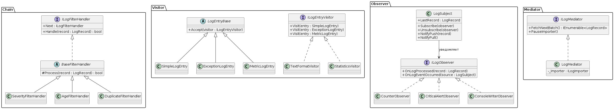

# Лабораторная работа 7. Конвейер обработки

**Выполнил:** Соколов Андрей Романович (БИСО-01-24)
**Вариант:** 10 (Windows Event Log (JSON-выгрузка))

## 1. Цепочка обязанностей (Chain of Responsibility)
Для фильтрации входящих записей реализован конвейер фильтров. 
*   **Порядок звеньев задается конфигурацией (в DI-контейнере):** `SeverityFilterHandler` 🡒 `AgeFilterHandler` 🡒 `DuplicateFilterHandler`.
*   **Пустой состав пропускает всё:** Если `Next == null`, базовый класс возвращает `true`.
*   **Расширяемость:** Добавление нового фильтра не требует правки старых (создается новый класс-наследник `BaseFilterHandler`).

## 2. Посетитель (Visitor)
Для выполнения операций над записями без изменения их классов реализован паттерн Посетитель.
*   **Три типа записей:** `SimpleLogEntry`, `ExceptionLogEntry`, `MetricLogEntry`.
*   **Два посетителя:** `TextFormatVisitor` (форматирование) и `StatisticsVisitor` (сбор статистики).
*   **Двойная диспетчеризация:** Метод `Accept` переопределен в каждом конкретном классе записи и вызывает `visitor.Visit(this)`.
*   **Ответ на контрольный вопрос:** Метод `Accept` нельзя вынести в базовый класс, так как в этом случае `this` будет иметь тип базового класса (`LogEntryBase`), и компилятор не сможет выбрать правильную перегрузку `Visit`.

## 3. Наблюдатель (Observer) и Модели Push/Pull
Реализован издатель `LogSubject` и три подписчика (`CounterObserver`, `CriticalAlertObserver`, `ConsoleWriterObserver`). Исключение в одном подписчике не прерывает рассылку для остальных (блок `try-catch`).
*   **Push-модель:** Издатель сам передает объект `LogRecord` в метод `OnLogProcessed` подписчика.
*   **Pull-модель:** Издатель передает только ссылку на себя (`OnLogEventOccurred(this)`), а подписчик сам забирает данные из свойства `LastRecord`.
*   **Обоснование выбора:** Для логов уместнее **Push**. Записи — это поток независимых событий. При Pull-модели подписчик может не успеть забрать данные, прежде чем издатель перезапишет `LastRecord` новой записью.

## 4. Посредник (Mediator) — Задание на 5 баллов
Прямые вызовы `ILogImporter` в `LogProcessor` заменены на `ILogMediator`. При перегрузке конвейер может приостановить импортер через посредника (`PauseImporter()`), не имея на него прямой ссылки.

## 5. Тестирование
Написано 14 тестов, покрывающих:
*   Работу каждого фильтра и порядок цепочки.
*   Двойную диспетчеризацию и добавление нового посетителя без правки записей.
*   Отписку от событий, устойчивость к ошибкам в подписчиках.
*   Эквивалентность Push и Pull моделей.
*   Приостановку конвейера через Посредника.

## 6. Диаграмма классов

## Вывод
В ходе работы были изучены поведенческие паттерны. Реализован гибкий конвейер обработки логов, соответствующий принципам SOLID.